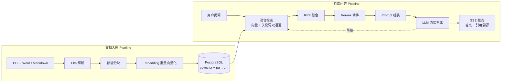

# 知行 Zhixing

> 知 = 检索增强（RAG），行 = 工具执行（Agent）。取"知行合一"之意：让模型既有据可知，又能动而行。

**知行是一个生产级 Agentic RAG 平台**，面向企业私有知识库场景，提供从文档接入、混合检索到流式问答与 Agent 执行的完整链路。

- 📄 **文档知识库**：PDF / Word 等格式一键接入，Tika 解析、智能分块、向量化入库，全程状态机可观测
- 🔍 **混合检索**：pgvector 向量召回 + pg_trgm 关键词召回，RRF 融合、Rerank 精排，精确匹配与语义理解两路兼得
- 💬 **流式问答**：SSE 增量输出，答案带引用溯源；知识库无据时明确拒答，不编造
- 🔌 **多模型接入**：DeepSeek / 智谱 GLM 开箱即用；一套抽象兼容所有 OpenAI 协议供应商，新供应商接入只写一个 20 行子类
- 🛡️ **生产化内建**：错误分类驱动的容错降级、链路追踪（Trace）落库、统一响应协议与三段式错误码
- 🤖 **Agent 执行**（开发中）：自研 ReAct 引擎 + MCP 工具接入 + 写操作人工确认挂起恢复

## 架构



所有节点耗时通过内建 Trace 表落库，检索与生成全链路可观测。

## 当前开发状态

项目活跃开发中，按以下顺序推进：

- ✅ 统一响应协议、A/B/C 三段错误码、全局异常翻译
- ✅ 模型客户端层：对话 / Embedding / Rerank 三接口，模板方法基类，纯函数 SSE 解析器，多供应商冒烟验证通过
- 🚧 文档入库：上传 → 解析 → 分块 → 向量化（状态机驱动）
- ⬜ 混合检索 / RRF 融合 / Rerank
- ⬜ 流式问答与引用溯源
- ⬜ 多轮对话：问题重写、会话记忆与摘要
- ⬜ ReAct Agent、MCP 工具、写操作人工确认
- ⬜ 容错降级与熔断、模块化拆分、Web 控制台

## 技术栈

| 维度 | 选型 | 说明 |
|:---|:---|:---|
| 语言/框架 | Java 17 + Spring Boot 3.5.x（Servlet 栈） | MVC + SseEmitter，流式输出零额外依赖 |
| ORM | MyBatis-Plus + 手写检索 SQL | 常规 CRUD 交给 MP；向量与融合检索手写 SQL，性能与行为可控 |
| 存储 | PostgreSQL 16 + pgvector + pg_trgm | **单库三用**：业务数据 + HNSW 向量索引 + GIN 全文索引，中间件 3 → 1 |
| 文档解析 | Apache Tika | 一个依赖覆盖 PDF / Word / PPT / HTML |
| 模型 | DeepSeek（对话主力）+ 智谱 GLM（备选 + embedding-3） | 均 OpenAI 兼容协议，一套抽象全覆盖；一主一备跨供应商降级 |

## 设计亮点

**模型客户端层**（`src/main/java/com/zhixing/infra/llm/`）

- 模板方法基类 `AbstractOpenAIStyleChatClient`：请求构建、状态码分类、SSE 循环、容错全部钉死在基类，供应商差异收敛为两个钩子——接入新供应商 = 一个 `provider()` + 若干钩子覆写
- SSE 解析器 `OpenAiStyleSseParser` 设计为**纯函数、无状态、永不抛异常**：LLM 真实流无法复现，但解析逻辑可以离线穷举，8 个单测覆盖标准流、坏行、error 事件等边界
- 容错三规则：单行解析失败降级跳过不断流；`finish_reason` / `[DONE]` 双重防御收尾（usage 块不丢、迟到 `[DONE]` 不毁答案）；HTTP 200 携带 error body 必须当失败
- `ErrorType` 枚举内建 `fallbackCapable` 标志：哪些错误值得切换备用供应商（网络/服务端/超时）、哪些切了也没用（鉴权/限流），阶段化降级直接读属性

**协议与可观测**

- HTTP 恒 200 + 业务码（`Result<T>`），前端一套解析逻辑通吃 JSON 与 SSE；错误码 A（客户端）/ B（服务端）/ C（远程模型）三段，C 段专用于模型调用
- `trace_run` / `trace_node` 表边写边埋点，每个检索与生成节点耗时入库，问答质量可回溯

## 快速开始

前置：JDK 17、Docker、[DeepSeek](https://platform.deepseek.com/) 与 [智谱](https://open.bigmodel.cn/) API Key。

```bash
# 1. 启动 PostgreSQL（含 pgvector 扩展）
docker run -d --name zhixing-pg -e POSTGRES_PASSWORD=postgres -p 5432:5432 pgvector/pgvector:pg16
docker exec -i zhixing-pg psql -U postgres -c "CREATE DATABASE zhixing;"

# 2. 建表（自带 CREATE EXTENSION vector / pg_trgm）
docker exec -i zhixing-pg psql -U postgres -d zhixing < src/main/resources/db/V1__init.sql

# 3. 配置模型 API Key（.env 已被 .gitignore 排除，不入库）
cp .env.example .env
vim .env          # 填入真实 key
source .env

# 4. 启动
./mvnw spring-boot:run

# 5. 验证
curl http://localhost:9090/api/health
# {"code":"0","message":"success","data":"zhixing up"}
```

### 测试

```bash
./mvnw test    # 离线单测：SSE 解析、错误分类、分片逻辑等，不联网

# 冒烟测试（真实调用模型 API，产生少量费用），需先 source .env
LLM_SMOKE=true ./mvnw test -Dtest='LlmSmokeTest,LlmZhipuPrimarySmokeTest'
```

切换主力对话供应商**只改一行 yaml**：`zhixing.llm.chat.primary` 从 `deepseek/deepseek-chat` 改为 `zhipu/glm-4-flash`。

## 项目结构

```
com.zhixing
├── common/        Result、ErrorCode(A/B/C 三段)、BusinessException、GlobalExceptionHandler
├── config/        LlmProperties、OkHttpConfig、LlmClientConfig（primary 按 yaml 路由）
├── controller/    HealthController
└── infra/llm/     ChatClient / EmbeddingClient / RerankClient 接口
                    ├─ AbstractOpenAIStyleChatClient    模板方法基类
                    ├─ OpenAiStyleSseParser             纯函数 SSE 解析器
                    ├─ DeepSeekChatClient / ZhipuChatClient
                    ├─ ZhipuEmbeddingClient             批量分片 + 按序回填
                    ├─ NoopRerankClient                 Rerank 扩展点
                    └─ ModelClientException + ErrorType 错误体系
resources/db/       V1__init.sql 全量建表（知识库 / 会话 / Trace 三域）
```

## Roadmap

| 阶段 | 交付 |
|:--|:---|
| 入库链路 | 上传 / Tika 解析 / 结构感知分块 / 批量向量化 / 文档状态机与幂等去重 |
| 检索问答 | 双通道检索、RRF 融合、Rerank、SSE 流式问答、引用溯源、检索质量评估集 |
| 多轮对话 | 问题重写、近 N 轮记忆 + 会话摘要 |
| Agent | 自研 ReAct 引擎、MCP 工具接入、写操作人工确认与挂起恢复 |
| 生产化 | 跨供应商容错降级、并行检索、Trace 查询、单体 → 多模块拆分 |
| 控制台 | Web 聊天界面 + 知识库管理页 |
