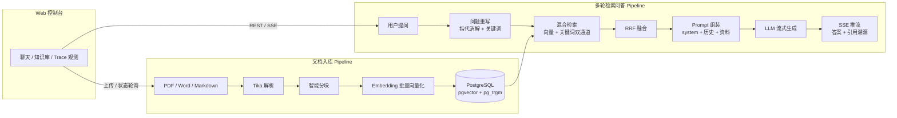

# 知行 Zhixing

> 知 = 检索增强（RAG），行 = 工具执行（Agent）。取"知行合一"之意：让模型既有据可知，又能动而行。

**知行是一个生产级 Agentic RAG 平台**，面向企业私有知识库场景，提供从文档接入、混合检索到多轮流式问答与 Agent 执行的完整链路。

- 📄 **文档知识库**：PDF / Word 等格式一键接入，Tika 解析、智能分块、向量化入库，全程状态机可观测，同库同文件幂等去重
- 🔍 **混合检索**：pgvector 向量召回 + pg_trgm 关键词召回，RRF 融合、Rerank 扩展位，精确匹配与语义理解两路兼得
- 💬 **多轮流式问答**：SSE 增量输出，答案带引用溯源；问题重写消解指代（"它充电多少瓦？""那 K80 呢？"不迷路），近 N 轮记忆 + 滚动摘要；知识库无据时明确拒答，不编造
- 🖥️ **Web 控制台**：聊天 / 知识库管理 / Trace 观测三页，开箱即用
- 🔌 **多模型接入**：DeepSeek / 智谱 GLM 开箱即用；一套抽象兼容所有 OpenAI 协议供应商，新供应商接入只写一个 20 行子类
- 🛡️ **生产化内建**：统一响应协议与三段式错误码、链路追踪（Trace）落库可查、文档幂等、会话历史全量持久化
- 🤖 **Agent 执行**（开发中）：自研 ReAct 引擎 + MCP 工具接入 + 写操作人工确认挂起恢复

## 架构



所有节点耗时通过内建 Trace 表落库，Web 控制台可视化查询，检索与生成全链路可观测。

## 快速开始

前置：JDK 17、Docker、Node.js 18+，以及 [DeepSeek](https://platform.deepseek.com/) 与 [智谱](https://open.bigmodel.cn/) API Key。

### 方式一：Docker Compose（推荐）

```bash
# 1. 配置模型 API Key（.env 已被 .gitignore 排除，不入库）
cp .env.example .env
vim .env          # 填入真实 key

# 2. 一键启动 PostgreSQL（pgvector/pg_trgm 自动扩展）+ 后端（自动建表）
docker compose up -d
# 首次构建需下载 Maven 依赖，请耐心等待；健康检查通过后服务在 9090 就绪

# 3. 启动前端
cd frontend && npm install && npm run dev

# 4. 打开 Web 控制台
# http://localhost:5173 → 知识库页上传文档 → 聊天页开始提问
```

### 方式二：本地开发

```bash
# 1. 启动 PostgreSQL（含 pgvector 扩展）
docker run -d --name zhixing-pg -e POSTGRES_PASSWORD=postgres -p 5432:5432 pgvector/pgvector:pg16
docker exec -i zhixing-pg psql -U postgres -c "CREATE DATABASE zhixing;"

# 2. 建表（自带 CREATE EXTENSION vector / pg_trgm）
docker exec -i zhixing-pg psql -U postgres -d zhixing < src/main/resources/db/V1__init.sql

# 3. 配置并启动后端
cp .env.example .env && vim .env && source .env
./mvnw spring-boot:run          # 默认连接 127.0.0.1:5432，可用 PG_URL/PG_USER/PG_PASSWORD 覆盖

# 4. 启动前端（同方式一第 3 步）

# 5. 验证
curl http://localhost:9090/api/health
# {"code":"0","message":"success","data":"zhixing up"}
```

数据库连接、模型 Key 均可通过环境变量覆盖（`PG_URL` / `PG_USER` / `PG_PASSWORD` / `DEEPSEEK_API_KEY` / `ZHIPU_API_KEY`）。

### 测试

```bash
./mvnw test    # 离线单测 95 例：SSE 解析、错误分类、分块、RRF、会话记忆等，不联网

# 冒烟测试（真实调用模型 API，产生少量费用），需先 source .env
LLM_SMOKE=true ./mvnw test -Dtest='LlmSmokeTest,LlmZhipuPrimarySmokeTest'

# 检索质量评测 runner（Hit@5 / Recall@5 / MRR@10）
# 注：内置评估集与演示语料暂未随仓库分发（zhixing.eval.set-path 可指向自建评估集）
EVAL_RUN=true ./mvnw test -Dtest=EvalRunner
```

切换主力对话供应商**只改一行 yaml**：`zhixing.llm.chat.primary` 从 `deepseek/deepseek-chat` 改为 `zhipu/glm-4-flash`。

## 技术栈

| 维度 | 选型 | 说明 |
|:---|:---|:---|
| 语言/框架 | Java 17 + Spring Boot 3.5.x（Servlet 栈） | MVC + SseEmitter，流式输出零额外依赖 |
| ORM | MyBatis-Plus + 手写检索 SQL | 常规 CRUD 交给 MP；向量与融合检索手写 SQL，性能与行为可控 |
| 存储 | PostgreSQL 16 + pgvector + pg_trgm | **单库三用**：业务数据 + HNSW 向量索引 + GIN 全文索引，中间件 3 → 1 |
| 文档解析 | Apache Tika | 一个依赖覆盖 PDF / Word / PPT / HTML |
| 模型 | DeepSeek（对话主力）+ 智谱 GLM（备选 + embedding-3） | 均 OpenAI 兼容协议，一套抽象全覆盖；一主一备跨供应商降级 |
| 前端 | React 18 + TypeScript + Vite + Tailwind CSS | 三页控制台；SSE 用 fetch 流式手解析（POST + SSE 不受 EventSource 限制） |

## 设计亮点

**模型客户端层**（`infra/llm/`）

- 模板方法基类 `AbstractOpenAIStyleChatClient`：请求构建、状态码分类、SSE 循环、容错全部钉死在基类，供应商差异收敛为两个钩子——接入新供应商 = 一个 `provider()` + 若干钩子覆写
- SSE 解析器 `OpenAiStyleSseParser` 设计为**纯函数、无状态、永不抛异常**：LLM 真实流无法复现，但解析逻辑可以离线穷举；前端 `sse.ts` 与之同构（帧状态跨 chunk 保留，粘包/半包有单测锁死）
- 容错三规则：单行解析失败降级跳过不断流；`finish_reason` / `[DONE]` 双重防御收尾（usage 块不丢、迟到 `[DONE]` 不毁答案）；HTTP 200 携带 error body 必须当失败
- `ErrorType` 枚举内建 `fallbackCapable` 标志：哪些错误值得切换备用供应商、哪些切了也没用，容错降级直接读属性

**多轮对话**（`core/memory/`）

- 问题重写消解指代与省略（"它充电多少瓦" → "小米15 Ultra 充电多少瓦"），失败自动降级原问题，链路永不中断
- 会话记忆 = 近 8 轮完整对话（窗口偶数对齐）+ 滚动摘要（第 9 轮触发，≤200 字），token 预算可控
- 内置检索质量评测 runner（Hit@5 / Recall@5 / MRR@10），每次调参前后各跑一次，用数字而非感觉驱动优化

**协议与可观测**

- HTTP 恒 200 + 业务码（`Result<T>`），错误码 A（客户端）/ B（服务端）/ C（远程模型）三段；前端一套解析逻辑通吃 JSON 与 SSE
- `trace_run` / `trace_node` 边写边埋点，Web 控制台可视化每个检索与生成节点的耗时

## 项目结构

Maven 多模块（依赖方向单向：bootstrap → core → llm → framework），每个包的职责与依赖规则见对应 `package-info.java`——包结构即架构文档。

```
zhixing
├── zhixing-framework   协议（common/Result+错误码）、配置装配（config/）、SSE 推流设施（infra/sse）
├── zhixing-llm         自研 OpenAI 兼容模型客户端（模板方法基类 + 纯函数 SSE 解析器 + 容错降级）
├── zhixing-core        核心域引擎与编排
│   ├── core/           ingest（入库管线）· retrieval（双通道+RRF）· memory（重写/记忆/摘要/长期记忆）
│   │                   eval（评估纯函数）· agent（ReAct 引擎/工具契约/确认管理）
│   ├── infra/          vector（pgvector）· keyword（pg_trgm）· storage · trace · mcp（MCP 接入）
│   ├── dao/            MyBatis-Plus entity/mapper（唯一手写 SQL 的层）
│   └── service/        用例编排：KbService · QaService · AgentService · agenttools（Agent 工具）
├── zhixing-bootstrap   Application + controller + application.yaml + prompts + db 脚本（可执行 jar）
└── frontend/           React 18 + TS + Vite + Tailwind 三页控制台
```

每个包的职责与依赖规则见对应 `package-info.java`——包结构即架构文档。

## Roadmap

| 版本 | 交付 |
|:--|:---|
| **v0.1**（当前） | RAG 全链路 + 多轮对话 + Web 控制台三页 + Docker Compose 一键部署 |
| v0.2 | 自研 ReAct Agent（复合任务）、写操作人工确认与挂起恢复、跨供应商容错降级与熔断、Agent 事件前端（thinking / 工具时间线 / 确认弹窗） |
| v1.0 | MCP 工具接入、简化版长期记忆、单体 → 多模块拆分 |

## License

[MIT](LICENSE)
